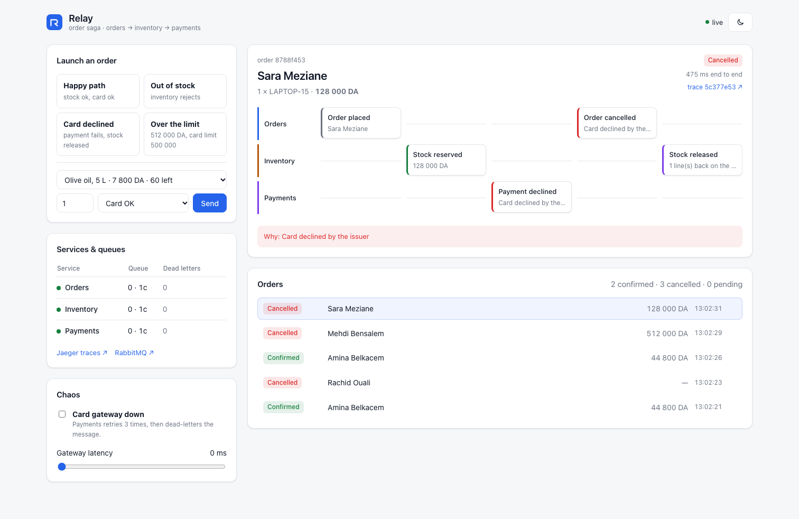
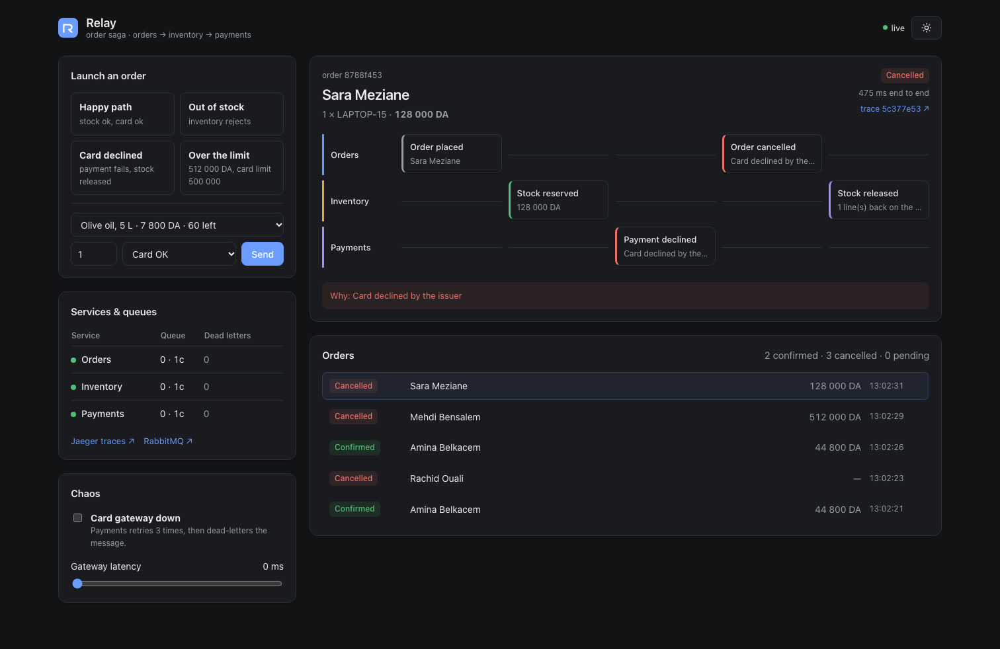
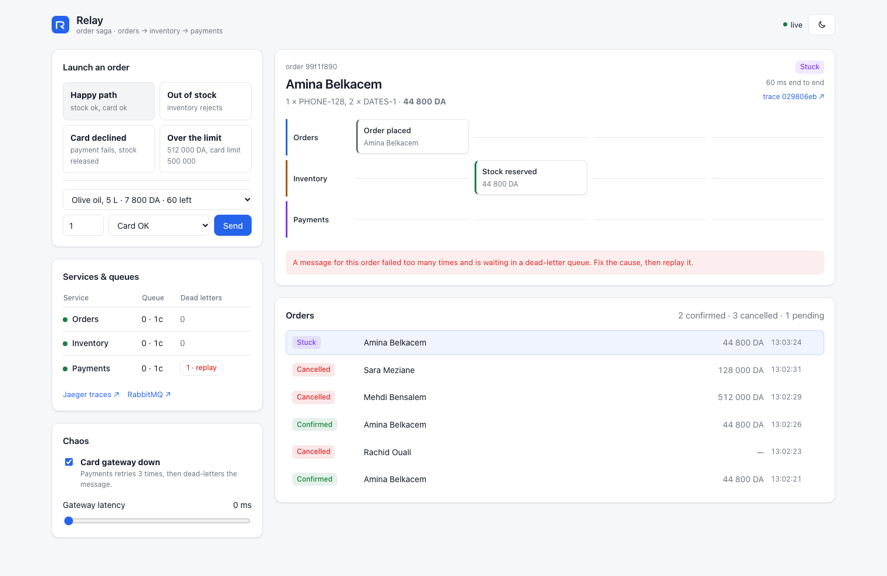
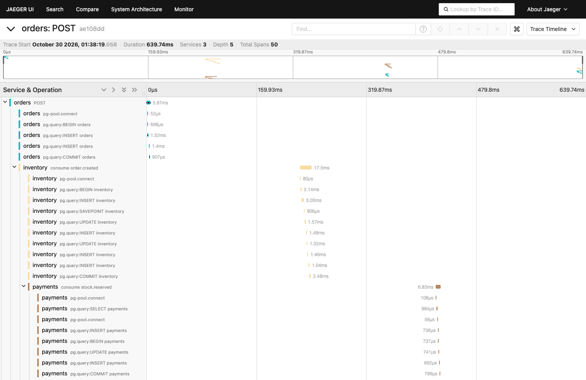
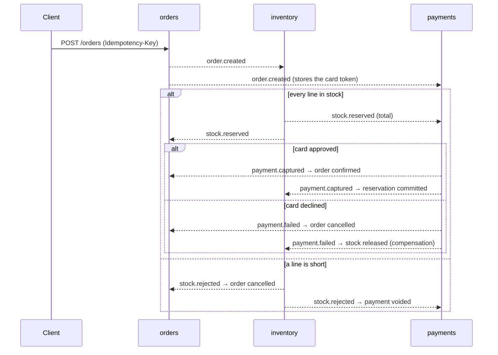
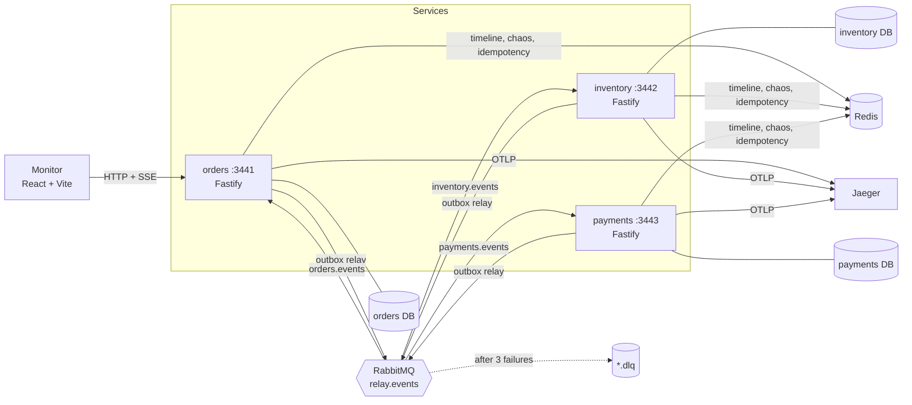

# Relay

**Relay** is an event-driven order system built as three microservices (orders, inventory, payments) that coordinate a checkout as a **saga**: no service calls another, each one reacts to events on RabbitMQ and publishes its own. When something fails halfway (a declined card after the stock was reserved), the saga runs **compensating actions** to undo the earlier steps.

It shows the patterns that make this reliable in production: the **transactional outbox**, an **idempotent inbox**, retries with backoff and a **dead-letter queue**, Redis for idempotency keys and a live timeline, and **OpenTelemetry** traces that follow one order across all three services in Jaeger. A React monitor lets you launch scenarios, break the card gateway on purpose and replay dead-lettered messages.



| Dark theme                                                   | A message in the dead-letter queue                  |
| ------------------------------------------------------------ | --------------------------------------------------- |
|  |  |

**One order, one trace, three services (Jaeger):**



## The saga



Dashed arrows are events on one RabbitMQ topic exchange (`relay.events`), routed by type. Each service has its own queue and its own PostgreSQL database.

## Architecture



```
relay/
├── packages/common/src/      shared by the services
│   ├── events.ts             event contracts (zod), the only coupling between services
│   ├── broker.ts             topology, confirm-channel publisher, consumer with retries + DLQ
│   ├── outbox.ts             enqueue() inside a transaction, relay loop with SKIP LOCKED
│   ├── inbox.ts              markProcessed(): deduplicate redelivered messages
│   ├── tracing.ts            W3C trace context in message headers, consumer spans
│   ├── telemetry.ts          OpenTelemetry SDK, loaded with --import before the service
│   └── timeline.ts           Redis Stream of saga steps for the monitor
├── services/
│   ├── orders/               HTTP API, saga outcome, SSE timeline, system status, chaos, DLQ replay
│   ├── inventory/            stock reservation with a savepoint, compensation
│   └── payments/             pretend card gateway with test tokens and chaos switches
├── apps/monitor/             React + Vite dashboard
├── scripts/                  migrate.ts (per-service databases), seed.ts
├── tests/                    unit/ and integration/ (all three services in one process)
└── e2e/                      Playwright on the monitor
```

## Run it

Requirements: Docker and Node 24.

```bash
cp .env.example .env
```

```bash
docker compose up -d --wait
```

```bash
npm install && npm run db:migrate && npm run db:seed
```

```bash
npm run dev
```

That starts the three services and the monitor:

- Monitor: http://localhost:5200
- Jaeger (traces): http://localhost:16687
- RabbitMQ management (guest / guest): http://localhost:15673

In the monitor, launch the four scenarios, then tick **Card gateway down** and launch a happy path: payments retries three times, the message goes to `payments.dlq` and the order shows as stuck. Untick it and press **replay**: the order completes.

Test card tokens: `tok_ok` (approved), `tok_declined`, `tok_insufficient`. Orders above 500 000 DA go over the card limit.

### Tests

```bash
npm test            # 5 unit tests + 6 integration tests that run the real saga on PostgreSQL, RabbitMQ and Redis
npm run test:e2e    # Playwright: happy path, compensation, dead-letter and replay, through the monitor
npm run lint && npm run typecheck && npm run format:check
```

The integration tests start all three services in one process on a separate RabbitMQ virtual host (`relay-test`), separate databases (`*_test`) and Redis database 1, so they can run next to the dev stack. They cover the happy path, a short line rolled back by a savepoint, compensation after a declined card, a duplicated message processed once, idempotent order creation, and dead-letter then replay.

## Key concepts

**Choreography, not orchestration.** No service tells another what to do. Orders publishes `order.created` and listens for outcomes; inventory and payments react to what they care about. Services stay independent (any of them can be down for a minute without losing work), at the cost of having no single place that "knows" the workflow. The monitor's swimlanes and the Jaeger trace give that view back.

**Transactional outbox.** "Save the order, then publish to RabbitMQ" can fail between the two steps, leaving a saved order that nobody hears about, or an event for an order that was rolled back. Here the event is a row in an `outbox` table written in the same database transaction as the order. A relay loop publishes committed rows and marks them as sent. It uses publisher confirms, so a row is marked only once RabbitMQ has stored the message, and `FOR UPDATE SKIP LOCKED`, so several instances can relay without sending a row twice.

**At-least-once delivery and the inbox.** The outbox can publish a row twice (crash after publishing, before marking), and RabbitMQ redelivers unacknowledged messages. Every consumer therefore records the event id in `processed_messages` in the same transaction as its own writes. A duplicate is detected and skipped, and an integration test publishes one on purpose.

**Compensation instead of distributed transactions.** There is no transaction spanning three databases. When payment fails after stock was reserved, inventory receives `payment.failed` and puts the stock back (`stock.released`). The order's state machine only moves from `pending`, so late or repeated events cannot reopen a finished order.

**Savepoints.** Reserving an order with several lines is all-or-nothing. If the third line is short, inventory rolls back to a savepoint taken before the first line: earlier reservations vanish, but the inbox row and the `stock.rejected` event are still committed together.

**Race-free stock.** `UPDATE products SET stock = stock - $n WHERE sku = $1 AND stock >= $n` checks and reserves in one statement, and a CHECK constraint keeps stock from ever going negative.

**Retries, backoff and the dead-letter queue.** A failing handler is retried with exponential backoff (0.5 s, then 1 s). After the third failure the message is rejected and RabbitMQ routes it, through the dead-letter exchange, to the service's `*.dlq` queue. Nothing is lost, and nothing blocks the queue behind it. Fix the cause, then **replay**: the messages go back with a fresh retry budget. Out-of-order arrival is handled the same way: if payments gets `stock.reserved` before its own copy of `order.created` is committed, the first attempt fails and the retry succeeds.

**Distributed tracing.** OpenTelemetry auto-instruments HTTP, Fastify, PostgreSQL and Redis. For RabbitMQ, the publisher stores the W3C `traceparent` in the message headers (copied into the outbox row so it survives until the relay sends it) and each consumer continues that trace. In Jaeger, one checkout is one trace across three services: the HTTP request, every SQL statement and every message hop.

**Redis, three ways.** `SET key value NX EX 86400` makes `POST /orders` idempotent with an `Idempotency-Key` header. A Redis **Stream** (`XADD` / `XREAD BLOCK`) is the saga timeline the monitor watches over Server-Sent Events. A hash holds the chaos switches the payments service reads.

**Contracts at the boundary.** `events.ts` is the only thing services share. Every consumed message is validated with zod, and payment details stay out of inventory's events (there is a test for that).

## Limits

- The services run with `npm` (or `tsx`); Docker Compose provides the infrastructure, not the services.
- Prices and card checks are deliberately simple. A real gateway would need webhooks and a timeout/expiry step in the saga.
- The outbox relay polls every 200 ms; PostgreSQL logical replication (Debezium) would push changes instead.
